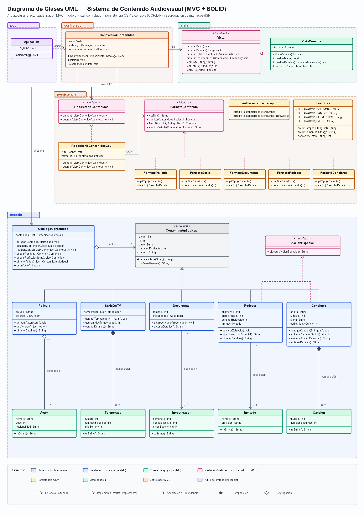

# Sistema de Contenido Audiovisual — POO Unidad 4

Sistema de consola en Java para la gestión de contenidos audiovisuales (**Películas**, **Series de TV**, **Documentales**, **Podcasts** y **Conciertos**), refactorizado aplicando **Código Limpio**, **Principios SOLID**, el patrón **MVC (Modelo–Vista–Controlador)**, persistencia en **CSV** y pruebas unitarias con **JUnit 5**.

---

## Cambios realizados por etapa

### Etapa 1: Manejo de archivos (CSV)
- Implementación de lectura y escritura de contenidos en `datos/contenidos.csv` (`tipo,titulo,duracion,genero,detalle`).
- Serialización y deserialización completa de los cinco tipos de contenido junto con sus entidades asociadas (`Actor`, `Temporada`, `Investigador`, `Invitado` y `Cancion`).
- Manejo explícito de errores de entrada/salida y formato mediante la excepción personalizada `ErrorPersistenciaException`.

### Etapa 2: Refactorización y Código Limpio
- Nombres claros y expresivos en clases, métodos, constantes y variables.
- División de métodos largos en métodos pequeños y específicos (por ejemplo `leerDatosBasicos`, `registrarContenido`, `repetir` y `detallesBase`).
- Eliminación de código duplicado y clases temporales/obsoletas (`MenuAudiovisual` y `PruebaCsv`), conservando únicamente comentarios necesarios que aportan contexto.

### Etapa 3: Principios SOLID
- **SRP (Responsabilidad Única):** separación clara entre entidades de negocio (`modelo`), colección en memoria (`CatalogoContenidos`), persistencia CSV (`persistencia`), entrada/salida (`vista`) y coordinación (`controlador`).
- **OCP (Abierto/Cerrado):** el repositorio CSV delega el formato de cada tipo a la interfaz `FormatoContenido` (`FormatoPelicula`, `FormatoSerie`, `FormatoDocumental`, `FormatoPodcast`, `FormatoConcierto`), permitiendo agregar nuevos tipos sin modificar `RepositorioContenidosCsv`.
- **LSP (Sustitución de Liskov):** todas las subclases de `ContenidoAudiovisual` se gestionan de forma polimórfica en el catálogo, la vista y la persistencia mediante `obtenerDetalles()`.
- **ISP (Segregación de Interfaces):** interfaces pequeñas y específicas (`AccionEspecial` implementada solo por `Podcast` y `Concierto`, además de `Vista`, `RepositorioContenidos` y `FormatoContenido`).
- **DIP (Inversión de Dependencias):** `ControladorContenidos` depende de las abstracciones `Vista` y `RepositorioContenidos`, recibiendo sus implementaciones por inyección de dependencias desde `Aplicacion`.

### Etapa 4: Patrón MVC
- **Modelo (`modelo`):** `ContenidoAudiovisual`, `Pelicula`, `SerieDeTV`, `Documental`, `Podcast`, `Concierto`, clases de apoyo (`Actor`, `Temporada`, `Investigador`, `Invitado`, `Cancion`), `AccionEspecial` y `CatalogoContenidos`.
- **Vista (`vista`):** interfaz `Vista` e implementación `VistaConsola`, encargada exclusivamente de la interacción por consola.
- **Controlador (`controlador`):** `ControladorContenidos`, encargado de coordinar el menú, el catálogo, la vista y el repositorio CSV.

### Etapa 5: Pruebas unitarias (JUnit 5)
- Suite de **37 pruebas unitarias** distribuidas en **8 clases** dentro de `test/`, cubriendo casos normales, límite y excepcionales para modelo, catálogo, persistencia CSV y controlador MVC.

---

## Estructura del proyecto

```text
Poo-contenido-audiovisual-U4/
├── datos/
│   └── contenidos.csv
├── docs/
│   └── diagrama_clases.png
├── src/
│   ├── controlador/
│   │   └── ControladorContenidos.java
│   ├── modelo/
│   │   ├── AccionEspecial.java
│   │   ├── Actor.java
│   │   ├── Cancion.java
│   │   ├── CatalogoContenidos.java
│   │   ├── Concierto.java
│   │   ├── ContenidoAudiovisual.java
│   │   ├── Documental.java
│   │   ├── Investigador.java
│   │   ├── Invitado.java
│   │   ├── Pelicula.java
│   │   ├── Podcast.java
│   │   ├── SerieDeTV.java
│   │   └── Temporada.java
│   ├── persistencia/
│   │   ├── ErrorPersistenciaException.java
│   │   ├── FormatoConcierto.java
│   │   ├── FormatoContenido.java
│   │   ├── FormatoDocumental.java
│   │   ├── FormatoPelicula.java
│   │   ├── FormatoPodcast.java
│   │   ├── FormatoSerie.java
│   │   ├── RepositorioContenidos.java
│   │   ├── RepositorioContenidosCsv.java
│   │   └── TextoCsv.java
│   ├── poo/
│   │   ├── Aplicacion.java
│   │   └── PruebaAudioVisual.java
│   └── vista/
│       ├── Vista.java
│       └── VistaConsola.java
└── test/
    ├── controlador/
    │   └── ControladorContenidosTest.java
    ├── modelo/
    │   ├── CatalogoContenidosTest.java
    │   ├── ConciertoTest.java
    │   ├── DocumentalTest.java
    │   ├── PeliculaTest.java
    │   ├── PodcastTest.java
    │   └── SerieDeTVTest.java
    └── persistencia/
        └── RepositorioContenidosCsvTest.java
```

---

## Diagrama de clases actualizado



---

## Cómo clonar y ejecutar el proyecto

### Requisitos
- **Java JDK 17 o superior** (el proyecto utiliza `record` y `switch` mejorado).
- **Eclipse IDE for Java Developers** (con soporte JUnit 5 incluido).

### Pasos
1. Clonar el repositorio:
   ```bash
   git clone https://github.com/AngelCab97/Poo-contenido-audiovisual-U4.git
   ```
2. En Eclipse, importar el proyecto: **File -> Open Projects from File System...** (o **Existing Projects into Workspace**) y seleccionar la carpeta clonada.
3. Ejecutar la aplicación principal: clic derecho sobre `src/poo/Aplicacion.java` -> **Run As -> Java Application**.
4. Desde el menú de consola puedes registrar contenidos, cargar datos de ejemplo (opción `11`), cargar desde `datos/contenidos.csv` (opción `12`) o guardar cambios en CSV (opción `13`).

---

## Cómo ejecutar las pruebas unitarias

1. En el **Package Explorer** de Eclipse, haz clic derecho sobre la carpeta **`test/`**.
2. Selecciona **Run As -> JUnit Test**.
3. Eclipse ejecutará las 8 clases de prueba con **JUnit 5** (37 pruebas en total) y mostrará el resultado en la pestaña **JUnit**.